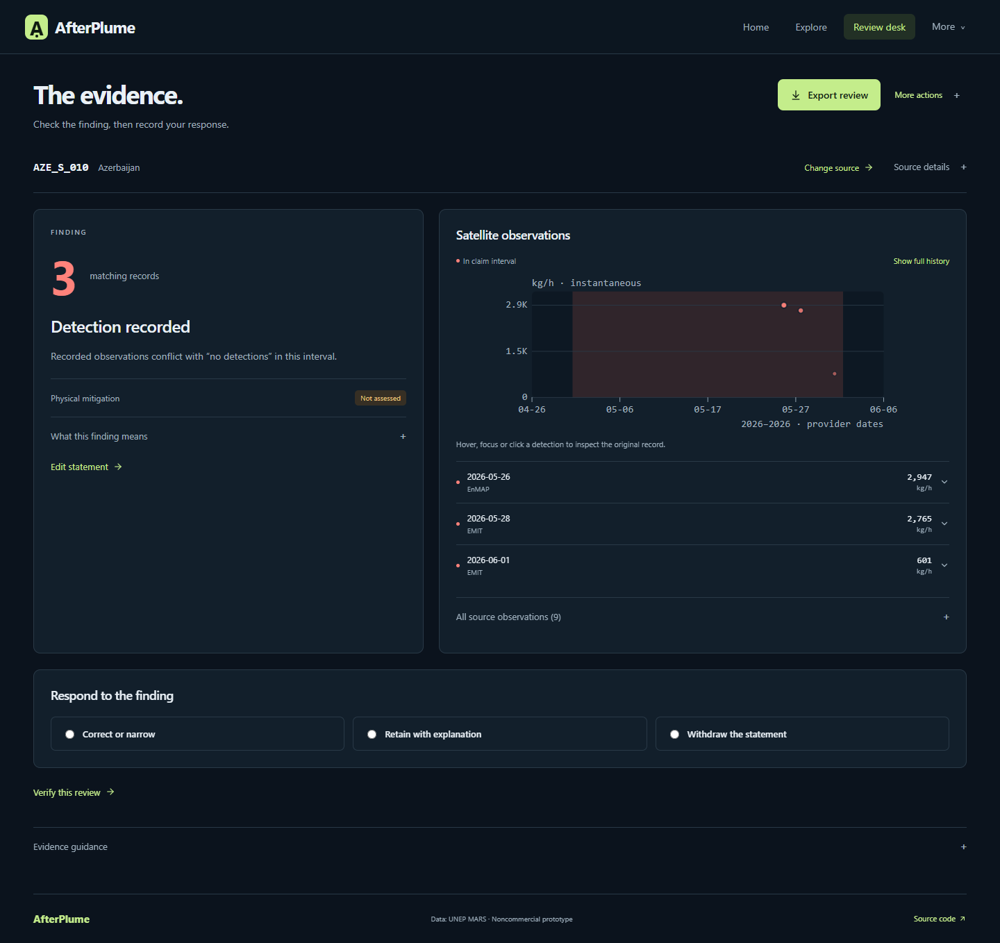
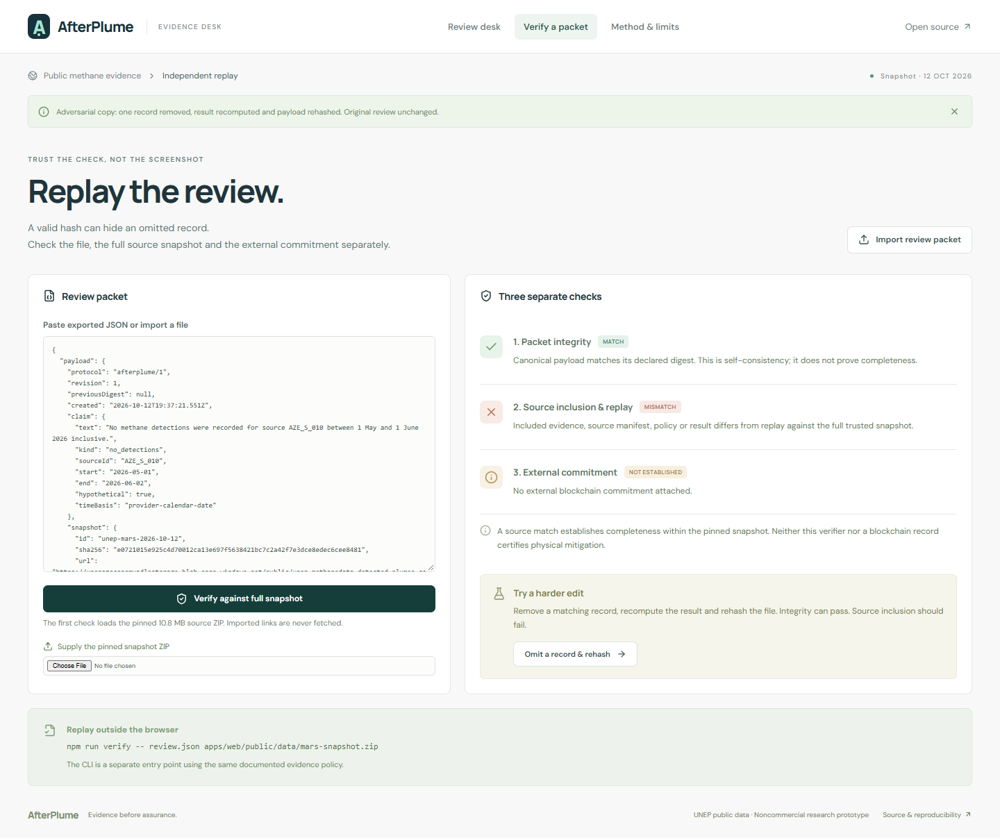

# AfterPlume

**Check the claim. Keep the evidence. Replay the review.**

**[Open the live evidence desk](https://afterplume.vercel.app)** · [Measured validation](docs/VALIDATION.md) · [Working walkthrough](docs/DEMO.md)

AfterPlume reviews a bounded methane statement against public detection data. It preserves the original claim, includes every matching observation, explains the evidence limits and exports a packet another person can replay. The example uses actual UNEP IMEO MARS records and an explicitly hypothetical statement; it makes no operator allegation.

## Try the hero flow

1. Open the review desk for provider source `AZE_S_010`.
2. Keep the example interval: 1 May 2026 included to 2 June 2026 excluded. Optionally run local assistance and confirm its suggested claim type.
3. Run the evidence check. Three source-assigned detection records fall in that interval. This contradicts only the bounded statement “no recorded detections.” Repair and mitigation remain unassessed.
4. Correct, retain with an explanation or withdraw the statement. The original text and observations remain visible.
5. Export the review or replay it in the verifier.
6. Try **Omit a record & rehash**. The edited copy can pass its own hash check while source inclusion and replay fail against the full original ZIP.

No account, wallet or paid API is needed for this flow. Optional ledger publication requires a separately configured test chain and wallet. A blockchain transaction records a digest, not scientific truth.

## Run locally

Requirements: Node.js 24 (22.12+ supported), npm. Python 3 is required only for regenerating the data fixture.

```bash
git clone https://github.com/kathir-iTech/AfterPlume.git
cd AfterPlume
npm ci
npm run model:prepare
npm run dev
```

Open `http://127.0.0.1:5173`. Model preparation downloads pinned, hash-checked files from Hugging Face. Inference runs locally in a browser worker. First use also loads the WASM runtime; cold loading and warm query inference are different measurements. Keyword retrieval remains available if model loading fails.

```bash
npm run check
npx playwright install chromium
npm run test:e2e
npm run evaluate
npm run build
```

The build prepares model files and outputs static assets in `apps/web/dist`. `vercel.json` configures a Vercel static deployment from this repository root. No environment secrets are required for the core application.

## Verify outside this app

```bash
npm run verify -- review.json apps/web/public/data/mars-snapshot.zip
```

Optional third argument: an explicitly chosen RPC endpoint for an attached, supported EVM receipt. The command reports packet integrity, source inclusion/replay and external commitment independently. `MATCH` without a complete source snapshot proves only file self-consistency. Imported packet links are never fetched. The CLI is a separate entry point sharing the documented policy engine, not an independent scientific certification.

## Local EVM ledger

Start a local chain in a second terminal:

```bash
npm run chain:local
```

Then deploy the actual Solidity contract:

```bash
npm run chain:deploy
```

The deployment writes a local configuration into `apps/web/public/ledger/local.json`. In a browser EVM wallet, connect to chain ID `31337`, RPC `http://127.0.0.1:8545` and use only the disposable local test accounts printed by Hardhat. Never send real funds to these accounts or use their publicly known keys on any funded network.

Complete a review, open optional blockchain publication and publish it. The owner can authorize a distinct reviewer address; switching to that reviewer allows an acknowledgement of the current exact revision. Publishing a later revision preserves the old acknowledgement as history. Owner withdrawal is terminal.

Local chain records are resettable and are labelled accordingly. A public testnet deployment is a separate configuration and is not implied by a passing contract test. No purchased ETH or paid RPC is required or assumed.

## Reproducible public data

The bundled original ZIP contains **30,319 plume rows and 4,211 sources**, captured on 12 October 2026. The small starting fixture includes nine observations for `AZE_S_010`; verification scans the full ZIP on demand. These counts are dataset properties, not users, repairs or avoided emissions.

```bash
npm run data:prepare
# Or supply the exact pinned archive:
python scripts/prepare_data.py /path/to/original-snapshot.zip
```

SHA-256: `e0721015e925c4d70012ca13e697f5638421bc7c2a42f7e3dce8edec6cee8481`. The provider's current download may change. The script refuses a different archive rather than silently changing the snapshot. A new snapshot requires explicit versioning and a new review.

UNEP source: [download](https://methanedata.unep.org/download-dataset), [field dictionary](https://methanedata.unep.org/dict-mars-plumes), [MARS overview](https://www.unep.org/topics/energy/methane/methane-alert-and-response-system-mars).

## Boundaries

- Detection-only data has no complete negative-observation denominator. An empty interval cannot certify cessation.
- Missing quantification still counts as a detection. All source-assigned sensors are considered.
- Rates are instantaneous kg/h, with reported standard deviation where available. The app does not annualize observations or calculate certified percentage reductions from isolated rates.
- Calendar dates preserve the provider timestamp strings without an assumed timezone conversion. Exact UTC claims require a documented time basis.
- A later plume does not prove that a repair never occurred. Field evidence and qualified follow-up are needed.
- Source assignment does not establish facility ownership or responsibility. Geographical proximity is not used to merge unassigned plumes.
- A hash proves consistency; replay checks inclusion within one snapshot. The provider ZIP is not digitally signed by UNEP.
- An authorized reviewer is an address, not a certified auditor. Acknowledgement is distinct from mitigation.
- The prototype has no demonstrated user adoption or measured emissions reduction.

## Architecture, evidence and licenses

Three layers: static evidence desk; shared deterministic policy and independent packet replay; optional nonfinancial Solidity revision registry. The embedding model only ranks cited guidance and suggests a human-confirmed type.

See [architecture](docs/ARCHITECTURE.md), [packet protocol](docs/PROTOCOL.md), [authored evaluation queries](evaluation/queries.json) and generated reports in `evaluation/results/`. Retrieval measurements compare BM25, semantic and hybrid ranking on scenario-separated development and holdout queries. They do not measure methane detection or fraud accuracy.

Actual checks: **53 evidence/packet tests and 19 EVM contract tests passed**. The authored holdout retrieval test ranked the expected guidance note first for **16/18 hybrid queries**, compared with **14/18 BM25 queries**. See [validation and limitations](docs/VALIDATION.md) for commands, device details, all engines and cold/warm measurements.





Additional [working screenshots](docs/screenshots/) and [walkthrough](docs/DEMO.md) document the complete flow.

Application code: [MIT](LICENSE). Public data: [separate noncommercial notices](DATA_LICENSE.md); adapted fixtures retain attribution and share-alike. Local model: [Apache-2.0 notice](MODEL_LICENSE.md). This is a noncommercial research prototype.
