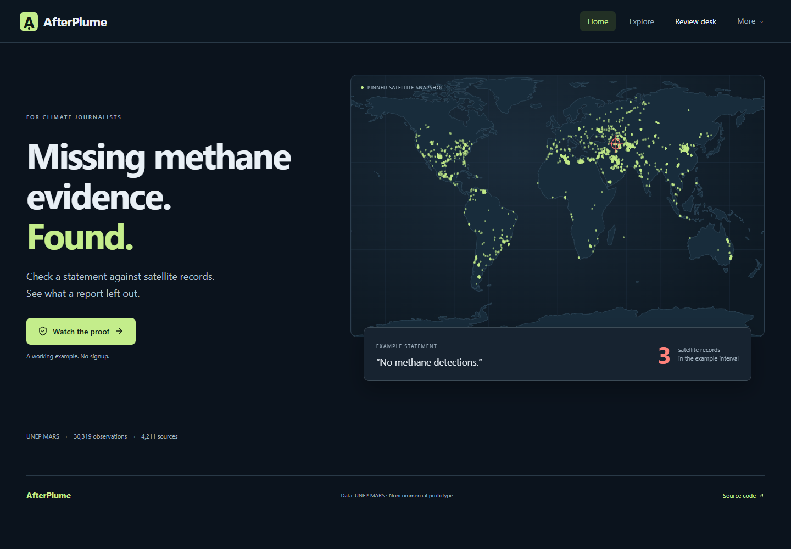
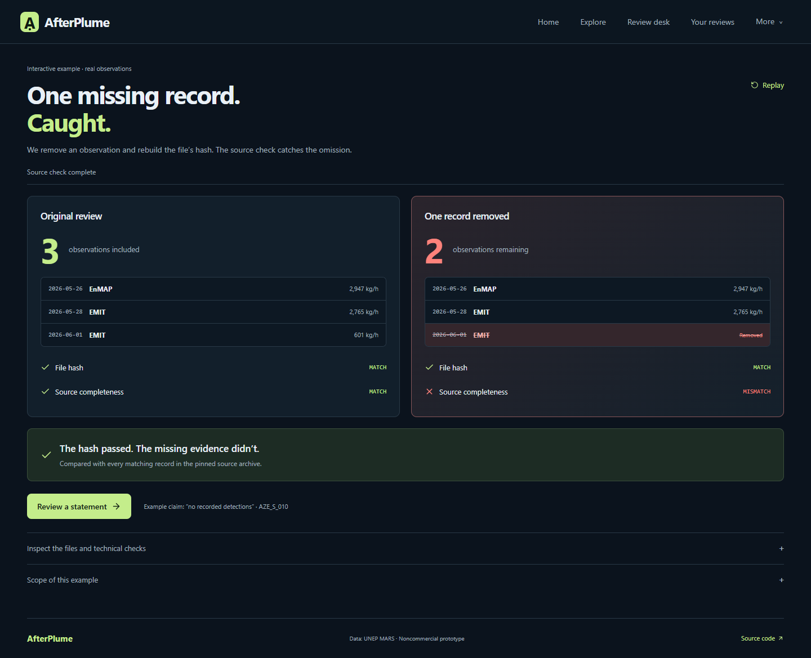

# AfterPlume

**For climate journalists: check what a methane report left out.**

[Open the app](https://afterplume.vercel.app) · [Watch the proof](https://afterplume.vercel.app/proof) · [Measured validation](docs/VALIDATION.md)

Choose a methane source, paste the statement you’re checking, and record a decision against public satellite observations. AfterPlume saves your work on your device and exports a file another reader can replay.

The interactive example removes one observation and rebuilds the file's hash. The hash passes; the source-completeness check catches the missing record. The statement is hypothetical, and the satellite records are real UNEP MARS observations.

## Try it

1. **Find a source:** search or select a location in Explore, then choose Review.
2. **Add your statement:** paste its exact wording, optionally note the document or URL, and confirm the claim type and dates. No statement is generated on your behalf.
3. **Inspect the evidence:** review every matching observation and the bounded finding.
4. **Record your decision:** correct or narrow, retain with explanation, or exclude the statement from your report. Complete the review before exporting and verifying it. **More actions → Download readable report** creates a standalone reading copy you can print to PDF; the JSON export is the replayable packet.
5. **Return to your work:** Your reviews contains saved decisions and unfinished drafts. Inputs survive reload; saved evidence is verified against the full snapshot before being displayed again.

The [proof example](https://afterplume.vercel.app/proof) and an explicit practice statement remain available for learning. Practice statements are labelled in their exported files. Browser storage is local to this device; export JSON to share or back up a completed review.

The [source explorer](https://afterplume.vercel.app/explore) includes all 4,211 provider sources. Batch tools, raw records and scientific context remain available behind labelled disclosures. Core review requires no account or paid API.

Built for **IEEE ClimateChain Global Hackathon**, **Climate Data & Environmental Monitoring**. The target user is a journalist investigating methane statements. See [event and judging criteria](https://ieee-climatechain-hack.devpost.com/), [product flow](docs/PRODUCT.md) and [architecture](docs/ARCHITECTURE.md).

## Run locally

Requirements: Node.js 24 (22.12+ supported), npm. Python 3 is required only for regenerating the data fixture.

```bash
git clone https://github.com/kathir-iTech/AfterPlume.git
cd AfterPlume
npm ci
npm run model:prepare
npm run dev
```

Open `http://127.0.0.1:5173`. Model preparation downloads pinned, hash-checked files from Hugging Face. Inference runs locally in a browser worker. First use also loads the WASM runtime; cold loading and warm query inference are different measurements. Keyword retrieval remains available if model loading fails.

```bash
npm run check
npx playwright install chromium
npm run test:e2e
npm run evaluate
npm run build
```

The build prepares model files and outputs static assets in `apps/web/dist`. `vercel.json` configures a Vercel static deployment from this repository root. No environment secrets are required for the core application.

## Verify outside this app

```bash
npm run verify -- review.json apps/web/public/data/mars-snapshot.zip
```

Optional third argument: an explicitly chosen RPC endpoint for an attached, supported EVM receipt. The command reports packet integrity, source inclusion/replay and external commitment independently. `MATCH` without a complete source snapshot proves only file self-consistency. Imported packet links are never fetched. The CLI is a separate entry point sharing the documented policy engine, not an independent scientific certification.

## Local EVM ledger

Start a local chain in a second terminal:

```bash
npm run chain:local
```

Then deploy the actual Solidity contract:

```bash
npm run chain:deploy
```

The deployment writes a local configuration into `apps/web/public/ledger/local.json`. In a browser EVM wallet, connect to chain ID `31337`, RPC `http://127.0.0.1:8545` and use only the disposable local test accounts printed by Hardhat. Never send real funds to these accounts or use their publicly known keys on any funded network.

Complete a review, open Blockchain test workspace and publish it. The owner can authorize a distinct reviewer address; switching to that reviewer allows an acknowledgement of the current exact revision. Publishing a later revision preserves the old acknowledgement as history. Owner withdrawal is terminal.

Local chain records are resettable and are labelled accordingly. A public testnet deployment is a separate configuration and is not implied by a passing contract test. No purchased ETH or paid RPC is required or assumed.

## Reproducible public data

The bundled original ZIP contains **30,319 plume rows and 4,211 sources**, captured on 12 October 2026. The small starting fixture includes nine observations for `AZE_S_010`; verification scans the full ZIP on demand. These counts are dataset properties, not users, repairs or avoided emissions.

```bash
npm run data:prepare
# Or supply the exact pinned archive:
python scripts/prepare_data.py /path/to/original-snapshot.zip
```

SHA-256: `e0721015e925c4d70012ca13e697f5638421bc7c2a42f7e3dce8edec6cee8481`. The provider's current download may change. The script refuses a different archive rather than silently changing the snapshot. A new snapshot requires explicit versioning and a new review.

UNEP source: [download](https://methanedata.unep.org/download-dataset), [field dictionary](https://methanedata.unep.org/dict-mars-plumes), [MARS overview](https://www.unep.org/topics/energy/methane/methane-alert-and-response-system-mars).

## Boundaries

- Detection-only data has no complete negative-observation denominator. An empty interval cannot certify cessation.
- Missing quantification still counts as a detection. All source-assigned sensors are considered.
- Rates are instantaneous kg/h, with reported standard deviation where available. The app does not annualize observations or calculate certified percentage reductions from isolated rates.
- Calendar dates preserve the provider timestamp strings without an assumed timezone conversion. Exact UTC claims require a documented time basis.
- A later plume does not prove that a repair never occurred. Field evidence and qualified follow-up are needed.
- Source assignment does not establish facility ownership or responsibility. Geographical proximity is not used to merge unassigned plumes.
- A hash proves consistency; replay checks inclusion within one snapshot. The provider ZIP is not digitally signed by UNEP.
- An authorized reviewer is an address, not a certified auditor. Acknowledgement is distinct from mitigation.
- The prototype has no demonstrated user adoption or measured emissions reduction.

## Architecture, evidence and licenses

Three layers: static evidence desk; shared deterministic policy and independent packet replay; optional nonfinancial Solidity revision registry. The embedding model only ranks cited guidance and suggests a human-confirmed type.

See [architecture](docs/ARCHITECTURE.md), [packet protocol](docs/PROTOCOL.md), [authored evaluation queries](evaluation/queries.json) and generated reports in `evaluation/results/`. Retrieval measurements compare BM25, semantic and hybrid ranking on scenario-separated development and holdout queries. They do not measure methane detection or fraud accuracy.

Actual checks: **65 unit tests and 19 EVM contract tests passed**. The authored holdout retrieval test ranked the expected guidance note first for **16/18 hybrid queries**, compared with **14/18 BM25 queries**. See [validation and limitations](docs/VALIDATION.md) for commands, device details, all engines and cold/warm measurements.






Additional [working screenshots](docs/screenshots/) and [walkthrough](docs/DEMO.md) document the complete flow.

Application code: [MIT](LICENSE). Public data: [separate noncommercial notices](DATA_LICENSE.md); adapted fixtures retain attribution and share-alike. Local model: [Apache-2.0 notice](MODEL_LICENSE.md). This is a noncommercial research prototype.

Map outlines: Natural Earth, public domain, served locally. Source positions are UNEP provider records and do not establish facility ownership. See [product flow and boundaries](docs/PRODUCT.md).
