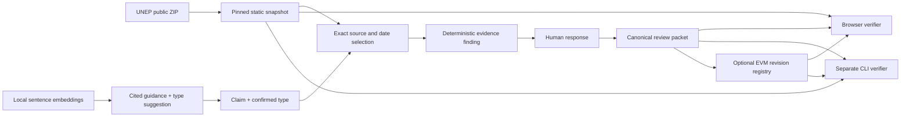

# Architecture

The app is static Vite, React and TypeScript. Vercel hosts built files; no server database, login, paid model API or relayer is required. The small seeded case loads first; full-source verification loads the original ZIP on demand. Local history is schema-validated and versioned in browser storage.

Transformers.js runs an Apache-2.0 MiniLM embedding model in a web worker using WASM. Model and runtime loading are separate from core review. An unavailable model uses explicitly labelled keyword retrieval. Human confirmation precedes any type change. Model inference cannot decide a finding.

The Solidity registry contains no funds, tokens, upgradeable proxy or payable operations. Owner addresses publish sequential revisions with the exact predecessor digest. Explicitly authorized, distinct reviewer addresses may acknowledge only a current active revision. Withdrawal is terminal. Deployment salt, chain ID and contract address prevent accidental reuse across reset local chains.

Public data fixtures retain UNEP attribution and noncommercial terms. Code and model have separate licenses. All source records and human narrative stay off-chain; only case identity, digests, role authorization and state transitions are recorded.
